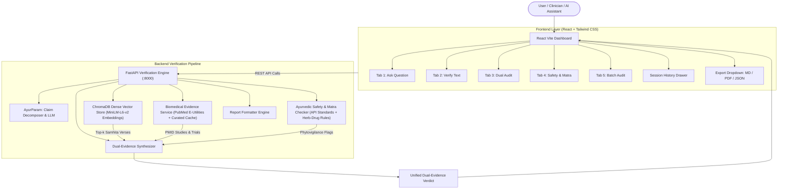

# 🌿 AyurEval (COGNEXA)
### Canonical & Biomedical Evidence Verification Framework for Ayurveda

[](https://fastapi.tiangolo.com)
[](https://react.dev)
[](https://vitejs.dev)
[](https://www.trychroma.com)
[](https://pubmed.ncbi.nlm.nih.gov)
[](LICENSE)

> **"Don't just generate an answer. Verify its evidence."**

**AyurEval (COGNEXA)** is an academic-grade, source-aware artificial intelligence verification framework designed to independently audit, decompose, cross-reference, and validate claims regarding Ayurvedic medicine against both canonical Sanskrit treatises (*Brihat Trayi*) and modern peer-reviewed biomedical literature (*PubMed*).

---

## 🏛 The Problem & Our Approach

Large Language Models (LLMs) frequently generate persuasive yet clinically perilous Ayurvedic advice, including:
- **Hallucinated Shlokas & Phantom Citations** (e.g. inventing non-existent verses in Charaka Samhita).
- **Misattributed Therapeutic Principles** (e.g. confusing Pitta-aggravating substances with Vata shamana).
- **Overstated Curative Claims** (framing preventative swasthavritta as permanent structural anatomical cures).
- **Dangerous Contraindications & Herb-Drug Interactions** (e.g. recommending high-dose Ashwagandha in pregnancy or Turmeric alongside anticoagulant therapy like Warfarin).

**AyurEval** solves this through a multi-hop, dual-evidence cross-auditor that grounds every claim in:
1. **The Classical Brihat Trayi**:
   - *Charaka Samhita* (Internal Medicine / Kaya Chikitsa)
   - *Sushruta Samhita* (Surgical Therapeutics / Shalya Tantra)
   - *Ashtanga Hridaya* (Synthesized Essence / Vagbhata)
2. **Authoritative Commentaries (*Bhashyas*)**:
   - *Chakrapani Datta* (*Ayurveda Dipika*)
   - *Dalhana* (*Nibandha Samgraha*)
   - *Arunadatta* (*Sarvangasundara*)
   - *Hemadri* (*Ayurveda Rasayana*)
3. **Contemporary Biomedical Science & Phytovigilance**:
   - NCBI PubMed Live E-Utilities (Randomized Controlled Trials, systematic reviews, mechanistic studies).
   - The *Ayurvedic Pharmacopoeia of India (API)* official maximum daily dosage limits (*Matra*) and *Anupana* adjuvants.

---

## 🔬 Core System Architecture



---

## 🌟 Key Capabilities & Workflows

### 1. Classical Claim Verification (`/api/v1/verify` & `/api/v1/ask`)
Deconstructs complex clinical advice into discrete atomic claims. Each claim is converted to a dense vector embedding (`all-MiniLM-L6-v2`) and queried against indexed *Brihat Trayi* shlokas, producing one of five strict verdicts:
- 🟢 `Supported by source` (Canonical citation + Sanskrit shloka + traditional commentary)
- 🟡 `Partially supported` (Classical backing present; clinical trial data limited)
- 🔴 `Contradicted by source` (Opposes classical Ayurvedic doctrine)
- ⚫ `Insufficient evidence` (Low semantic concordance in indexed texts)
- ❓ `Reference not verified` (Catches fabricated/hallucinated verse citations)

### 2. Classical vs. Biomedical Dual-Evidence Cross-Audit (`/api/v1/biomedical/dual-audit`)
Simultaneously audits statements against classical texts and modern medical research, assigning a unified dual-evidence grade:
- 🟢 **Dual-Supported**: Validated by canonical Samhitas and confirmed by modern RCTs.
- 🟡 **Traditional-Only**: Prescribed classically; modern clinical trial literature is limited.
- 🔵 **Clinical-Backed**: Corroborated by modern pharmacological trials; classical textual references are indirect.
- ⚪ **Partially Aligned**: Moderate evidence in one stream; inconclusive overall.
- 🔴 **Contradicted**: Disputed by either classical literature or modern pharmacology.

### 3. Phytovigilance, Classical Matra & Contraindications (`/api/v1/safety/check`)
Scans prescriptions and statements for patient safety:
- **Clinical Contraindications**: Flags high-risk conditions (e.g., pregnancy, bleeding disorders, acute Pitta aggravation, gallstones).
- **Classical Matra (Dosage Bounds)**: Compares stated doses against *Ayurvedic Pharmacopoeia of India (API)* safe thresholds.
- **Classical Anupana**: Recommends authentic adjuvants (e.g., warm milk, honey, ghee, warm water).
- **Herb-Drug Interactions**: Flags hazardous combinations (e.g., Turmeric/Guggulu with Warfarin/Aspirin, Ashwagandha with sedatives/thyroid medication).

### 4. High-Throughput Batch Claim Verification (`/api/v1/verification/batch`)
Allows clinicians and researchers to paste up to 10 newline-separated assertions. Concurrently runs vector retrieval and safety audits, providing a comprehensive analytics summary alongside per-claim details.

### 5. Multi-Format Academic Export & Session Management
- **Markdown (.md)**: Publication-ready reports with tables, blockquotes, and citations.
- **Print / PDF**: Clean, print-styled browser view (`window.print()`).
- **Raw JSON (.json)**: Full structured schema data for downstream clinical EHR integration.
- **Local History**: Client-side `localStorage` caching with instant session restoration and filtering.

---

## 🛠 Tech Stack

| Layer | Technology | Purpose |
|-------|------------|---------|
| **Backend Framework** | **FastAPI** (Python 3.10+) | High-performance asynchronous REST API with Pydantic v2 schemas |
| **Vector Database** | **ChromaDB** | Persistent dense embedding vector store for Sanskrit corpora |
| **Embedding Model** | **SentenceTransformers** (`all-MiniLM-L6-v2`) | High-accuracy 384-dimensional dense semantic vectors |
| **Biomedical Integration** | **NCBI PubMed E-Utilities API** | Live query of MEDLINE clinical trials and peer-reviewed studies |
| **Phytovigilance Rules** | **Custom Ayurvedic Safety Engine** | Formulated from Ayurvedic Pharmacopoeia of India (API) standards |
| **Frontend Framework** | **React 18** + **Vite 5** | Responsive Single Page Application with optimized bundle splitting |
| **Styling & UI** | **Tailwind CSS** + **Lucide React** | Academic, clinical-grade responsive typography and color coding |
| **HTTP Client** | **Axios** | Configured with timeout buffers for cold-start semantic embedding queries |

---

## 📁 Repository Structure

```
ayureval/
├── backend/
│   ├── app/
│   │   ├── api/
│   │   │   └── endpoints/
│   │   │       ├── ayurparam.py      # Question generation & claim decomposition
│   │   │       ├── biomedical.py     # PubMed search & Dual-Evidence Cross-Auditor
│   │   │       ├── export.py         # Markdown and JSON report download
│   │   │       ├── rag.py            # ChromaDB vector search & corpus ingestion
│   │   │       ├── safety.py         # Phytovigilance, Matra & Contraindications
│   │   │       └── verification.py   # Single & Batch claim verification
│   │   ├── core/
│   │   │   └── config.py             # Pydantic Settings & environment config
│   │   ├── models/
│   │   │   └── schemas.py            # Pydantic v2 validation models
│   │   ├── services/
│   │   │   ├── ayurparam.py          # Claim decomposition & clinical synthesis
│   │   │   ├── biomedical_service.py # PubMed E-Utilities client & curated evidence
│   │   │   ├── corpus_loader.py      # NIIMH web scraper & JSON file parser
│   │   │   ├── report_formatter.py   # Academic Markdown formatters
│   │   │   ├── safety_checker.py     # Ayurvedic safety & contraindication scanner
│   │   │   ├── vector_store.py       # ChromaDB client & dense retrieval
│   │   │   └── verification/
│   │   │       ├── auditor.py        # 4-stage classical verification pipeline
│   │   │       └── dual_auditor.py   # Dual-evidence cross-auditor engine
│   │   └── main.py                   # FastAPI application & OpenAPI metadata
│   ├── data/
│   │   ├── chroma/                   # Persistent ChromaDB vector index
│   │   ├── scientific/
│   │   │   ├── curated_evidence.json # Verified botanical clinical trials
│   │   │   └── safety_guidelines.json# Classical Matra, Anupana & contraindications
│   ├── tests/
│   │   └── test_e2e_integration.py   # 9-workflow comprehensive E2E test suite
│   ├── requirements.txt              # Backend Python dependencies
│   └── .env.example
├── frontend/
│   ├── src/
│   │   ├── components/
│   │   │   ├── BatchReportView.jsx       # Tab 5: Batch analytics & claims table
│   │   │   ├── DualAuditReportView.jsx   # Tab 3: Dual-evidence side-by-side view
│   │   │   ├── ErrorBoundary.jsx         # Graceful UI render crash recovery
│   │   │   ├── ExportButton.jsx          # Dropdown for MD, PDF, JSON export
│   │   │   ├── HistoryDrawer.jsx         # Slide-over saved session browser
│   │   │   ├── SafetyReportView.jsx      # Tab 4: Phytovigilance & Matra cards
│   │   │   ├── Toast.jsx                 # Transient status and alert banners
│   │   │   └── VerificationReportView.jsx# Tabs 1 & 2: Shloka citation cards
│   │   ├── services/
│   │   │   └── api.js                # Axios HTTP client & endpoint methods
│   │   ├── utils/
│   │   │   ├── exportReport.js       # Client-side Markdown, JSON & PDF printer
│   │   │   └── historyManager.js     # LocalStorage session manager
│   │   ├── App.jsx                   # Master dashboard workspace & tab switcher
│   │   ├── main.jsx                  # React DOM mount point
│   │   └── index.css                 # Tailwind directives & typography
│   ├── package.json                  # Frontend dependencies & build scripts
│   ├── vite.config.js                # Vite build config
│   └── tailwind.config.js            # Tailwind theme tokens
├── start_backend.bat                 # One-click Windows launcher for FastAPI
├── start_frontend.bat                # One-click Windows launcher for Vite
└── README.md
```

---

## 🚀 Quickstart Guide

### 1. Prerequisites
- **Python**: 3.10 or higher
- **Node.js**: 18.0 or higher
- **npm** or **pnpm**

---

### 2. Backend Setup

```bash
cd backend

# Create and activate a Python virtual environment
python -m venv venv

# Windows:
.\venv\Scripts\activate
# Linux/macOS:
source venv/bin/activate

# Install dependencies
pip install -r requirements.txt

# Create environment configuration
cp .env.example .env

# Run FastAPI backend server
uvicorn app.main:app --host 0.0.0.0 --port 8000 --reload
```

- **Interactive Swagger UI**: [http://localhost:8000/api/v1/docs](http://localhost:8000/api/v1/docs)
- **ReDoc Technical Reference**: [http://localhost:8000/api/v1/redoc](http://localhost:8000/api/v1/redoc)
- **Health Endpoint**: [http://localhost:8000/api/v1/health](http://localhost:8000/api/v1/health)

---

### 3. Frontend Setup

```bash
cd frontend

# Install Node dependencies
npm install

# Start Vite development server
npm run dev
```

- **Web Dashboard**: [http://localhost:5173](http://localhost:5173)

---

### 4. One-Click Launchers (Windows)

For convenience on Windows machines, two launchers are provided in the project root:
- Double-click `start_backend.bat` to activate the venv and start FastAPI on port 8000.
- Double-click `start_frontend.bat` to launch the Vite dev server on port 5173.

---

## 📡 API Endpoint Reference

| Method | Endpoint | Description |
|--------|----------|-------------|
| `GET` | `/api/v1/health` | Service health status and readiness check |
| `POST` | `/api/v1/ask` | Clinical inquiry synthesis via AyurParam + automated classical audit |
| `POST` | `/api/v1/verify` | Audits external AI text; decomposes claims & retrieves Samhita citations |
| `POST` | `/api/v1/biomedical/search` | Queries PubMed and curated databases for clinical evidence on herbs |
| `POST` | `/api/v1/biomedical/dual-audit` | Simultaneous Classical Samhita + PubMed dual-evidence cross-auditor |
| `POST` | `/api/v1/safety/check` | Phytovigilance, Matra (dosage bounds), Anupana, and drug interaction scanner |
| `POST` | `/api/v1/verification/batch` | Concurrently audits up to 10 claims and returns statistical summary analytics |
| `POST` | `/api/v1/export/report` | Transforms audit reports into downloadable Markdown (.md) or JSON files |
| `POST` | `/api/v1/rag/search` | Dense vector semantic search against ChromaDB *Brihat Trayi* corpus |
| `POST` | `/api/v1/rag/ingest-sample` | Seeds ChromaDB with canonical Charaka, Sushruta, and Vagbhata shlokas |

---

## 🧪 Comprehensive E2E Testing

AyurEval includes a comprehensive end-to-end integration test suite exercising all 7 core workflows against the live server:

```bash
cd backend
python tests/test_e2e_integration.py
```

### Test Suite Execution Output
```text
=================================================================
  AyurEval (COGNEXA) E2E Integration Test Suite
=================================================================

✓ [Workflow 1A] Health check verified: status=healthy
✓ [Workflow 1B] ChromaDB RAG search verified: 2 passage(s) retrieved
✓ [Workflow 2A] Verify answer verified: 1 atomic claim(s) audited
✓ [Workflow 2B] Ask & verify complete: answer synthesized and cross-audited
✓ [Workflow 3] Biomedical search verified: 2 clinical study/studies found
✓ [Workflow 4] Dual audit verified: 2 claim(s), grades=['Partially aligned', 'Dual-supported']
✓ [Workflow 5] Safety check verified: 6 alert(s) detected, is_safe=False
✓ [Workflow 6] Batch verification verified: 3 claims audited with analytics
✓ [Workflow 7] Export report verified: Markdown attachment successfully generated

=================================================================
  Summary: 9 PASSED, 0 FAILED out of 9 tests
=================================================================
```

---

## ⚖️ Disclaimer & Citation

> **Clinical Disclaimer**: AyurEval (COGNEXA) is an evidence-auditing research framework. It does not provide medical diagnoses, treatment prescriptions, or replace individualized clinical evaluation by a registered Ayurvedic physician (*Vaidya*) or medical practitioner.

If using AyurEval in academic research, please cite:
```bibtex
@article{ayureval2026,
  title={AyurEval (COGNEXA): A Source-Aware Canonical and Biomedical Dual-Evidence Verification Framework for Ayurveda},
  author={AyurEval Research Initiative},
  journal={Open Science in Integrative Medicine},
  year={2026}
}
```

---

## 📜 License
Distributed under the **Apache 2.0 / Academic Open Science License**. See `LICENSE` for details.
